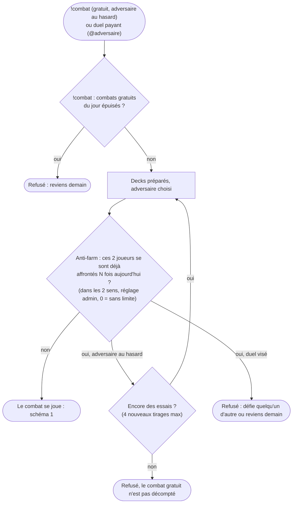
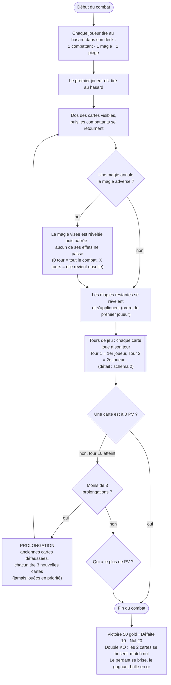
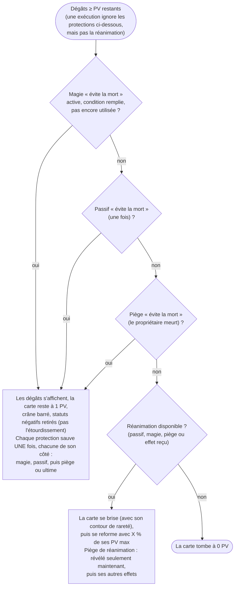
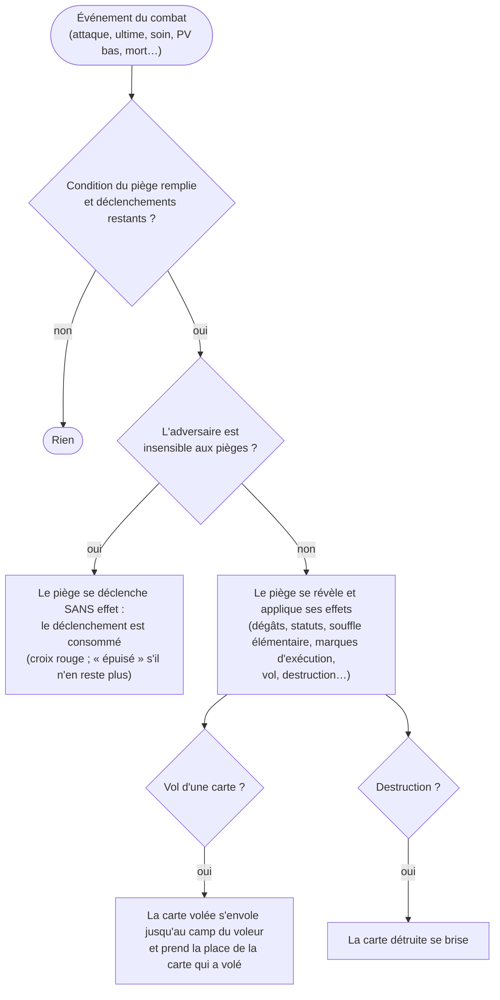

# Déroulé d'un combat — Forest Card

Schéma tiré directement du moteur (`moteur-combat.js`, identique dans `combat.html` et `swift-responder.ts`).
**À mettre à jour à chaque changement de règle** — les tests (`npm test`) vérifient que le moteur respecte ces règles.

## 0. Avant le combat (lancement depuis le chat)

## 1. Vue d'ensemble

## 2. Le tour d'une carte (ordre fixe, qu'elle joue en premier ou en deuxième)

```mermaid
flowchart TD
  T0([Tour de la carte]) --> T1["1. Début de tour<br/>· malédiction qui s'estompe : l'ATQ perdue revient (morceau par morceau)<br/>· malédiction : l'ATQ baisse<br/>· contre-attaque renforcée préparée<br/>· régénération<br/>· passif Solidification : X % de chances de se solidifier"]
  T1 --> T2{"2. Ultime prêt ?<br/>(après X tours ou quand une carte s'active,<br/>utilisations max, délai)"}
  T2 -- oui --> T2a["Ultime (aura rouge) → effets<br/>→ pièges « l'adversaire utilise son ultime »"]
  T2 -- non --> T3
  T2a --> T3{"3. Peut-elle attaquer ?"}
  T3 -- "étourdie" --> T3x[Elle saute son attaque]
  T3 -- "attaque annulée" --> T3x
  T3 -- "gel : attaque annulée ou paralysée (chance)" --> T3x
  T3 -- oui --> AT["Attaque : nombre de frappes<br/>(frappe multiple, enchaînement qui retente)<br/>fracture : chance de se blesser"]
  AT --> FR["Pour chaque frappe :<br/>esquive ? → sinon dégâts = ATQ (×2 si doublés, + rage, + bonus)<br/>réduction de dégâts · coup mortel ? (schéma 3)<br/>renvoi de dégâts · vol de vie · statuts posés par l'attaque<br/>(cible solidifiée : l'étourdissement est sans effet ;<br/>une fracture brise la solidification)<br/>attaquant transcendé : chaque coup qui touche purifie l'adversaire<br/>Exécution : X % de poser une marque (3 max) ; cible à 3 marques<br/>laissée sous X % de PV (10 %) → exécutée, même si elle évite la mort"]
  FR --> PG["Pièges « l'adversaire a attaqué N fois »<br/>(toutes les N attaques, jusqu'au maximum)"]
  T3x --> T4
  PG --> T4["4. Effets « à chaque tour »<br/>effet aléatoire · soin · ATQ / PV qui augmentent tous les X tours"]
  T4 --> T5["5. Statuts de fin de tour<br/>brûlure / poison (mêmes dégâts à chaque tour,<br/>cumul seulement s'ils sont réappliqués)<br/>saignement · purifications · dégâts différés"]
  T5 --> T6["6. Fin des durées<br/>gel · fracture · fatigue (ATQ rendue) · rage → fatigue<br/>dégâts doublés · renvoi<br/>insensibilité terminée → piège adverse réactivé s'il lui reste des déclenchements<br/>annulation de magie terminée → la magie revient<br/>solidification de l'adversaire : −1 tour (elle protège pendant ses tours à lui)<br/>Transcendance : après X tours joués (4) → purifiée, étourdissement retiré,<br/>ATQ +X % et PV max +X % (15 %), jusqu'à la fin du combat"]
  T6 --> TF([Au tour de l'autre carte])
```

## 3. Coup mortel, protections et pièges

## 4. Déclenchement d'un piège

